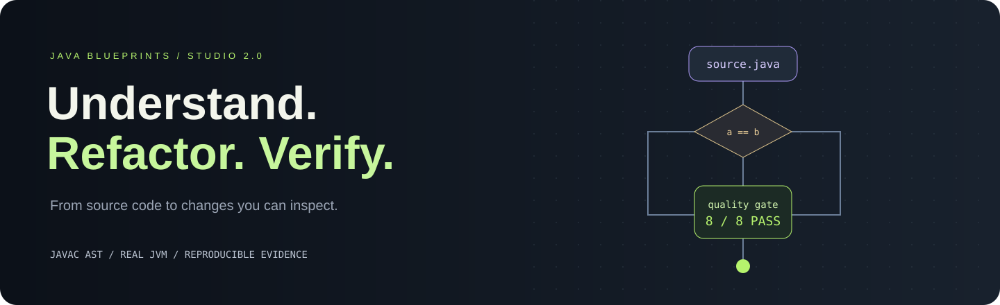
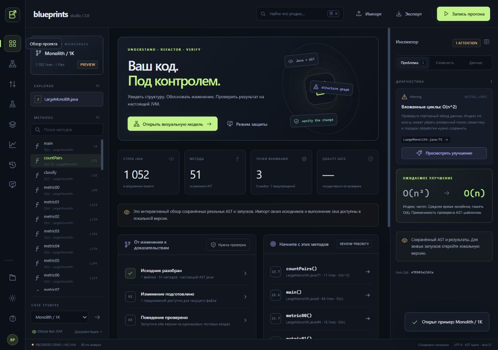
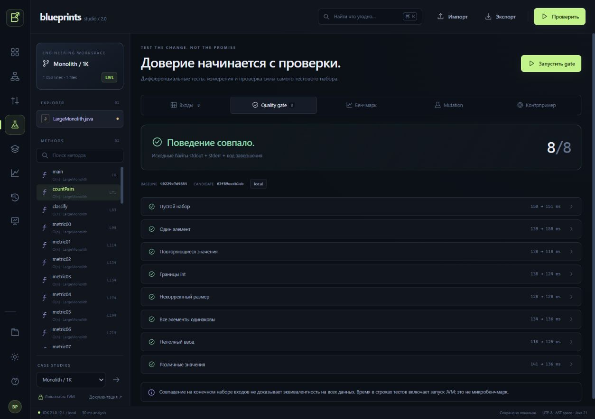

> Это инструкция отдельной расширенной Studio на `expert.html`. Основной визуальный конструктор описан в [README.md](README.md). Цифры ниже относятся к проверенному инженерному этапу Studio 2; актуальный полный итог с конструктором — 205 тестов в docs/verification-summary.json.

<p align="center"></p>

<p align="center"><b>Визуальный рефакторинг Java с настоящим компилятором и проверяемым результатом.</b><br>JDK 21 · Native ES modules · 0 runtime dependencies · UTF-8 · Local first</p>

<p align="center"><a href="#запуск">Запуск</a> · <a href="docs/DEMO.md">Демо за 5 минут</a> · <a href="docs/ARCHITECTURE.md">Архитектура</a> · <a href="docs/TESTING.md">Проверки</a> · <a href="docs/SCOPE.md">Scope кейса</a></p>

Java Blueprints Studio связывает исходник, граф потока управления, зависимости методов, объяснимые предложения и лабораторию проверки изменений. Код разбирает **javac AST**; обе версии компилируются и исполняются в отдельных JVM. Успешный отчёт относится к конкретным исходникам и входам.

Решение кейса AXENIX Java Blueprints. В комплекте монолит **1052 строки / 51 метод**, языковой showcase, три интерактивных примера, автоматические проверки, документация и PDF для защиты.





## Что показать жюри

| Возможность | Что действительно происходит |
|---|---|
| **Код ↔ граф** | AST → структурный CFG. Выбор узла находит строку, правка узла меняет Java по UTF-16 span. Zoom, pan, minimap, пути, ручная раскладка. |
| **План до изменения** | Пять семейств AST-преобразований: diff, причина, допущения, source hash. Устаревший или перекрывающийся план отклоняется. |
| **Quality gate** | Раздельные javac и JVM, точные raw stdout/stderr/exitCode. Compile error, timeout и output flood всегда FAIL. |
| **Mutation Lab** | Мутации реальных AST-операторов, компиляция и запуски. Killed / survived / invalid показывают силу выбранных тестов. |
| **Контрпример** | Бюджетный ddmin сокращает массив и значения; каждый шаг и финальный retained input проверяются JVM. |
| **Бенчмарк внутри JVM** | 3 warmup, медиана 3–9 samples метода static int method(int[]). Старт JVM и clone входа вне таймера. |
| **Архитектура проекта** | Граф вызовов, SCC/циклы, fan-in/out, hotspots, кандидаты на выделение модулей. Разрешение вызовов лексическое. |
| **25 диагностик** | 5 базовых + 20 дополнительных правил, severity, исходная строка, обоснование; SARIF 2.1.0. |
| **Данные и сложность** | Def/use, доминаторы, достижимость и структурные пути. Big O с явными допущениями. |
| **Evidence bundle** | ZIP: baseline/candidate Java, stdin, hashes, patch, JSON и автономный HTML. SVG / Mermaid / DOT для графа. |
| **История** | Undo/redo, checkpoints, восстановление, autosave, Ctrl+K поиск, темы, режим защиты. |
| **Отменяемые задачи** | Ограниченная очередь, состояния и стадии. Поздний ответ не прикрепится к новой ревизии кода. |

## Запуск

Нужен **полный JDK 21+**, не JRE. Приложение не требует Node, Python, Maven, npm, ключей или интернета.

Windows: двойной клик **start-local.cmd**. Или PowerShell:

```powershell
.\start.ps1 -TrustedLocal
```

Linux / macOS:

```sh
BLUEPRINTS_RUNNER=local sh start.sh
```

Открыть **http://localhost:8080**. JAVA_HOME указывает на JDK; Windows-скрипт также находит `.runtime/jdk*`. Runtime в архив не включён. Без флагов `start.ps1` оставляет исполнение выключенным, анализ и редактирование доступны. Другой порт: `-Port 8090`.

Trusted local выполняет программы с правами пользователя: используйте доверенные исходники. Для отдельных контейнеров на каждый запуск предусмотрен `start.ps1 -Docker`; Docker здесь не проверен. `docker compose up --build` поднимает весь сервис в одном контейнере и не изолирует пользователей друг от друга.

**Studio 2 поставляется только локально по выбору владельца.** Полная версия находится в этом комплекте и архиве. Её статическая сборка показывает явно помеченные записи реальных прогонов, без JVM; произвольные Java работают в локальной полной версии. [Существующий Site](https://java-blueprints-lab.husainov-565.chatgpt.site) содержит предыдущую версию; его содержимое и аудитория не изменялись. Для защиты запускайте Studio 2 локально.

## Сценарий за пять минут

1. Открыть Monolith / 1K, выбрать countPairs: два вложенных цикла и O(n²).
2. Рефакторинг и diff → Просмотреть патч → Применить и проверить. Частотный индекс заменит парный обход, gate проверит восемь входов.
3. Test Lab → Бенчмарк. Сравнить накладные расходы HashMap на малом n и выигрыш на большом.
4. Mutation: проверить, замечают ли входы изменения операторов. Score не является покрытием строк.
5. В исходном Pair Analyzer изменить a == b на a != b, получить FAIL и уменьшить неуспешный вход во вкладке Контрпример.
6. Восстановить checkpoint, выделить независимый static-метод в helper, повторить gate, экспортировать Evidence ZIP.

Подробные шаги и ответы жюри: [DEMO.md](docs/DEMO.md).

## Тесты и объём

**166 автоматических тестов: 108 unit + 22 базовых API + 36 Studio API.** Последний полный локальный прогон: [verification-summary.json](docs/verification-summary.json). Интеграционные тесты используют HTTP, настоящий javac и дочерние JVM. Unit diff дополнительно проверяет 300 детерминированных случайных последовательностей правок.

```sh
python tests/verify.py
```

Для тестов нужны JDK 21+, Node 22+, Python 3.10+. Скрипт сам собирает сервис, поднимает loopback:18080, сохраняет отчёты и останавливает процесс. NODE_BINARY задаёт путь к Node. Подробности: [TESTING.md](docs/TESTING.md). CI recipe включён; удалённый GitHub Actions здесь не запускался.

Продукт превышает **12 000 непустых строк без тестов**. [SOURCE-AUDIT.md](docs/SOURCE-AUDIT.md) и `python tests/source_audit.py` дают точную разбивку Java / JavaScript / CSS / HTML / Python и каждый файл. Не считаются зависимости, сборка, JSON, примеры, дубли, docs и SVG. CSS показан отдельно; объём не является метрикой качества.

## Реальные измерения

Результаты: [BENCHMARKS.md](docs/BENCHMARKS.md), [studio-reference-results.json](docs/studio-reference-results.json). Полные samples, параметры и среда находятся в web/studio-demo.json. На малом входе HashMap может проигрывать. Harness демонстрационный, не JMH и не обещание такого же ускорения на другой машине.

## Карта проекта

```text
src/                  AST, CFG, анализ, планы, runner, jobs, evidence
web/lib/              состояние, diff, layout, lexer, поиск, storage, ZIP
web/components/       source editor, graph canvas, inspector, shell
web/views/            8 рабочих экранов Studio
examples/             PairAnalyzer, LargeMonolith, LanguageShowcase, TextPipeline
tests/verify.py        единый полный прогон
tests/unit/           Node test runner без пакетов
docs/                 архитектура, API, scope, результаты, сценарий защиты
output/pdf/           визуальный материал для защиты
.github/workflows/    воспроизводимый CI recipe
```

## Гарантии и границы

Нетронутый текст сохраняется точными span-правками; UTF-8 используется на вводе/выводе/экспорте. Смысл Java задаёт стандартная JVM. Граф структурный: exceptional flow, метки и сложные выражения могут быть непрозрачными. Произвольное рисование рёбер с генерацией любого Java не реализовано.

Big O, data flow и call graph эвристические: нет полного type/alias/dispatch-анализа. Переписывания имеют узкие предикаты. Новая память может менять OutOfMemoryError. Gate подтверждает наблюдаемое поведение на конечных входах, SHA-256 идентифицирует содержимое и не является подписью. Jobs живут в памяти; после рестарта нужны новые прогоны. Скачанный evidence остаётся автономным. Подробности: [ARCHITECTURE.md](docs/ARCHITECTURE.md), [SCOPE.md](docs/SCOPE.md).
