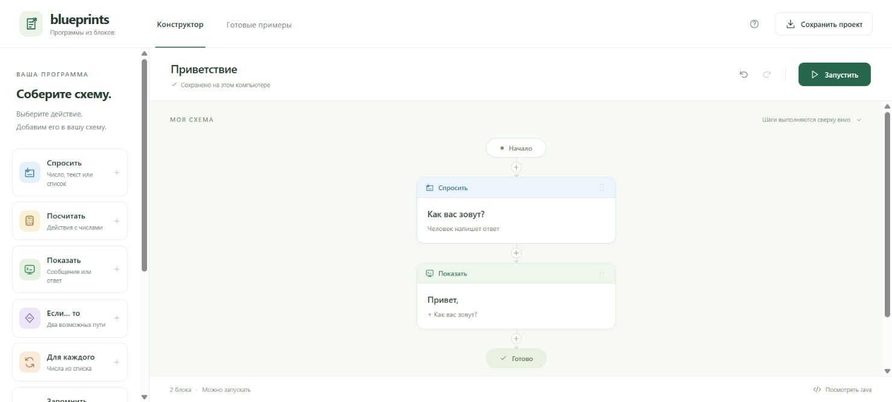

# Blueprints · Программы из понятных блоков

**Соберите логику, заполните поля и получите работающую Java-программу. Писать код в основном сценарии не нужно.**



## Запуск

Windows: двойной клик **start-local.cmd**. Затем открыть **http://localhost:8080**. Нужен полный JDK 21+, без npm, Maven и API-ключей. В подготовленной рабочей папке JDK уже находится в .runtime; в переносимый архив он не включён.

```powershell
.\start.ps1 -TrustedLocal
```

Linux/macOS: `BLUEPRINTS_RUNNER=local sh start.sh`. Trusted local выполняет доверенные программы с правами пользователя. Docker-путь подготовлен, но не проверен в этой среде.

## Попробуйте за минуту

1. Откройте **Готовые примеры → Скидка в магазине**.
2. Нажмите блок условия: измените порог покупки обычным числом.
3. Нажмите **Запустить**, введите сумму, затем **Получить результат**.
4. Добавьте новый шаг через плюс. Выберите **Показать** и напишите своё сообщение.
5. Нажмите **Сохранить проект**: скачаете визуальную схему, Main.java и инструкцию запуска.

Пять примеров: приветствие, скидка, сумма покупок, доставка и повторение. JSON-схемы и сгенерированная Java также находятся в [examples/blueprints](examples/blueprints).

## Что изменилось в продукте

| Раньше | Теперь |
|---|---|
| Сначала исходник, AST и технические метрики | Сначала понятная задача и визуальные шаги |
| Постоянные панели анализа | Настройки только выбранного блока |
| Код как главный способ создания | Блоки и формы; Java создаётся автоматически |
| Консольный ввод и технический отчёт | Вопросы обычными словами и готовый ответ |
| Инструменты инженера на первом экране | Расширенная Studio открывается отдельно |

Шесть основных действий, ещё четыре — в раскрываемом разделе. Условия имеют ветки «Да / Нет», повторы содержат вложенные шаги. Блоки можно добавлять между шагами, переносить, копировать, удалять и восстанавливать. Autosave хранит схему в браузере. Код доступен кнопкой **Посмотреть Java**.

Полный конструктор работает через реальную JVM. Без Java-сервера остаётся ограниченный режим **Предпросмотр в браузере** с явной подписью. Пояснение результата — trace визуальной модели, а не отладчик JVM.

## Для разработчика

**205 автоматических тестов: 141 unit + 22 базовых API + 36 Studio API + 6 Builder API.** Подробный последний результат: [verification-summary.json](docs/verification-summary.json). Интеграционные проверки выполняют настоящий javac и отдельные JVM, включая программы, созданные только из блоков.

```sh
python tests/verify.py
python tests/source_audit.py
```

Для тестов нужны JDK 21+, Node 22+, Python 3.10+. NODE_BINARY задаёт путь к Node. Полный скрипт создаёт отдельный loopback-сервер на 18080 и останавливает его. [Тестирование](docs/TESTING.md) · [Аудит строк](docs/SOURCE-AUDIT.md) · [Устройство конструктора](docs/BUILDER.md).

```text
web/builder/          визуальная модель, scope, Java compiler, модельный trace, templates, view
web/builder.mjs       взаимодействия, history, autosave, импорт/экспорт, live run
web/builder.css       светлый интерфейс конструктора
web/expert.html       прежняя Studio анализа и рефакторинга
src/VisualExecution.java  отдельная реальная compile/run задача
examples/blueprints/  пять переносимых проектов из блоков
```

Прежние AST-графы, анализ Java-монолита, refactor plans, differential gate, mutation/reducer/benchmark и evidence bundle доступны по ссылке **Расширенная Studio**. Их инструкция: [README-EXPERT.md](README-EXPERT.md). Архитектура всего решения: [ARCHITECTURE.md](docs/ARCHITECTURE.md), [API](docs/API.md), [соответствие кейсу](docs/SCOPE.md), [защита](docs/DEMO.md).

## Границы

Конструктор создаёт простые консольные программы: целые int, текст, списки чисел, арифметика, условия и повторы. До 60 блоков, пяти уровней вложенности и 1000 повторений. Деление целочисленное. Вопросы расположены вне веток и циклов. Более широкий Java scope остаётся в расширенной Studio. Бизнес-примеры объясняют логику и не подключаются к реальным магазинам.

Полный локальный комплект находится в **output/Java-Blueprints-complete.zip**. По выбору владельца публикация не выполняется; существующий удалённый Site содержит предыдущую версию. Для актуального показа используйте локальный предпросмотр.
