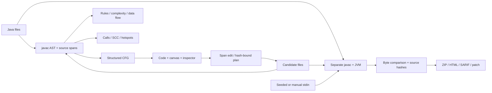

# Архитектура Blueprints: конструктор и Studio

Основной вход — визуальный конструктор: типизированная схема → проверка scope и типов → генерация Main.java → реальная JVM. Дерево блоков является источником истины; код создаётся автоматически. Архитектура этого пути подробно описана в BUILDER.md.

Отдельный расширенный режим expert.html сохраняет анализ существующих Java-проектов. Для него исходник — источник истины, AST-граф — проекция, а результат относится к конкретным версиям и входам. Ниже описан этот инженерный контур.

## Сервер и анализ

BlueprintServer использует JDK HttpServer, шесть HTTP-потоков. Тяжёлые операции v2 идут в JobService: два worker, очередь 12, максимум 48 задач истории. Состояния queued → running → completed / failed / cancelled. Прогресс отражает стадии, не выдуманный ETA. Данные jobs не переживают рестарт.

JavaModel использует JavacTask.parse, Trees и SourcePositions. Синтаксическая модель не означает успешного разрешения типов: полную сборку делает Runner. Offsets UTF-16 совпадают с Java String и browser textarea. GraphBuilder строит entry/exit, инструкции, if/switch, циклы, return и немеченые break/continue. GraphAnalysis вычисляет reachability, Tarjan SCC, доминаторы, shortest/bounded paths. Выполнимость условий не решается; exception-flow консервативен, без полной exceptional CFG.

ComplexityAnalysis складывает последовательные участки через max, вложенные циклы перемножает. Литеральная конечная граница считается константой, геометрический шаг может дать log. Вызовы, рекурсия, эффекты и реальные границы требуют проверки. DataFlowAnalysis — чтения/записи по именам, не SSA или alias analysis; затенённые переменные могут консервативно объединяться.

ProjectAnalysis разрешает вызовы по имени/арности/владельцу. Overload, наследование и внешние вызовы не моделируются полностью. Review risk: `2*cyclomatic + 1.5*cognitive + 0.15*lines`; это прозрачная эвристика ранжирования. Analyzer и RuleCatalog дают 5+20 explainable rules с source locations.

## Правки

Узкая замена span сохраняет нетронутый текст и комментарии. После правки сервер перепроверяет синтаксис. Вставка возле объявления ограничена для сохранения scope. Перемещение узла влияет только на layout.

RefactorPlans: histogram-pairs, string-builder, integer-fold, constant-branch, guard-clause. План содержит before/after, диапазоны, причину, допущения и source hash. Apply заново вычисляет предложения, выбирает IDs, отклоняет stale hash и overlap. Клиент не может подсунуть текст rewrite как готовый план. Int folding учитывает overflow/shifts, не сворачивает деление на ноль.

Transformations.extract переносит независимый static-метод в helper с delegate. Компиляция всех файлов отбрасывает недоступные поля/типы/контекст. Успешная сборка сама по себе не доказывает поведение.

## Runner и лаборатории

Отдельные временные каталоги, `javac --release 21 -encoding UTF-8`, отдельная JVM на запуск. Сравнение raw stdout/stderr hashes и exitCode до декодирования UTF-8. Одинаковые timeout/output overflow всё равно FAIL.

Пределы: compile 15s, execute 2.5s, heap 96 MiB, output 64 KiB на поток, максимум два исполнения одновременно. Interrupt уничтожает процесс и его потомков. Это не security sandbox: trusted local только для доверенного кода. Docker runner подготовлен, но здесь не проверен. Публичный многопользовательский сервис исполнения не заявляется.

InputCases генерирует schema-driven int-array / single-int / text-line с seed; до 30 случаев, int-array до 256. Не выводит произвольный stdin-протокол из Java.

MutationLab: до 8 мутантов и 8 входов, invalid исключены из score, equivalent mutants возможны. CounterexampleLab: n+n int, n≤256, 2–40 попыток ddmin/value shrinking, финальная повторная проверка; глобальная минимальность не гарантируется.

BenchmarkLab: доступный static int method(int[]), 3 warmup и 3–9 samples, clone до таймера, checksum результата, отдельные JVM для версий. Нет контроля forks/GC/affinity как в JMH.

## Клиент и доказательства

Native ES modules разделяют controller, чистую логику, компоненты и восемь views. Workspace транзакционный: изменения source/baseline инвалидируют результаты; смена stdin инвалидирует gate и лаборатории. Revision отклоняет запоздалые ответы. Undo/redo восстанавливает source, но требует нового gate. Autosave хранит данные и ограниченные snapshots, не серверные модели.

SVG canvas имеет собственные layout/routing, pan/zoom/minimap. Editor сохраняет caret/scroll и native text undo. Display lexer не парсит Java. Diff — bounded Myers с lossless fallback. ZIP — UTF-8 STORE + CRC32; traversal, backslash, drive и NUL в путях отклоняются.

Evidence выдаёт verified manifest только для завершённого compare job с подходящими hashes карт исходников. Произвольный клиентский JSON не становится verified. SHA-256 — идентичность содержимого, не подпись и не защита от замены всего комплекта.

HTTP слушает loopback, проверяет Host/Origin, ограничивает JSON 2 MB. Имена файлов проверяются перед записью; CSP блокирует внешние scripts, source/console text экранируются. Эти меры не превращают trusted JVM в песочницу.

На статическом Site JVM нет. Клиент использует помеченные записанные модели, планы и результаты трёх примеров. Произвольные Java требуют локальной полной версии.

## Выборы и цена

| Решение | Причина | Цена |
|---|---|---|
| javac + JVM | Стандартная Java и библиотека | Полный JDK |
| Span edits | Сохранение комментариев | Ограниченные структурные правки |
| Ноль runtime-пакетов | Запуск без install и сети | Собственные diff/layout/ZIP тестируются |
| Jobs в памяти | Простота и отмена без инфраструктуры | Нет durability |
| Differential gate | Проверяемые outputs | Не доказательство всех входов |
