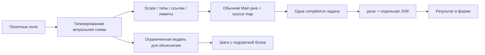

# Визуальный конструктор

Главная страница теперь предназначена для человека, который хочет собрать простую программу, не изучая синтаксис Java. Он выбирает задачу, добавляет блоки, заполняет обычные поля, нажимает «Запустить» и видит ответ. Java создаётся автоматически и доступна отдельной кнопкой. Прежняя техническая Studio находится на expert.html.

## Пользовательский сценарий

1. Готовый пример или чистая схема.
2. Блоки «Спросить», «Посчитать», «Показать», «Если… то», «Для каждого», «Запомнить число».
3. Настройки только выбранного блока: имя значения, действие, числа или значения из предыдущих шагов.
4. Условия расходятся на «Да / Нет». Повторы содержат свои шаги внутри. Плюс добавляет действие в конкретное место.
5. Запуск открывает форму с понятными вопросами и результатом, без терминала.
6. Пояснение результата показывает последовательность действий визуальной модели и подсвечивает нужный блок.
7. ZIP сохраняет схему, Main.java и инструкцию. JSON можно снова открыть в конструкторе.

Есть undo/redo, копирование поддерева с переназначением ссылок, перенос блоков между позициями, autosave и локальный импорт. При удалении нужного значения зависимые блоки отмечаются, запуск не создаёт некорректный Java. Все изменения остаются локальными.

## Архитектура

model.mjs хранит дерево структурных блоков. Ссылки используют стабильные IDs; человеческие имена не становятся Java-идентификаторами. Scope вычисляется до каждого шага: значения внутри ветки или повтора не выходят наружу. Для блока повтора доступен локальный элемент/номер, который нельзя использовать как изменяемый аккумулятор.

compiler.mjs генерирует Java из проверенного IR. Пользователь не вводит Java-выражения: операторы выбираются из разрешённого набора, текст экранируется. Комментарии нейтрализуют Unicode escape-последовательности Java. Source map связывает строки с блоками.

runtime.mjs — ограниченная модель того же IR с Java int-семантикой. Пояснение является модельным trace, не JVM debugger. Для живого backend пользователь получает именно stdout дочерней JVM. Trace показывается рядом с Java-результатом только при совпадении нормализованного stdout модели и JVM. Без backend явно отмечается «Предпросмотр в браузере».

VisualExecution использует existing Runner: одна компиляция и один запуск, compile/runtime errors и лимиты не становятся успехом. Ответ связан с project/input SHA-256. Revision/token клиента отклоняет результат устаревшего запуска, редактирование отменяет текущую задачу.

## Осознанные ограничения

Это конструктор простых консольных программ и учебных алгоритмов. Он не автоматизирует реальный магазин и не подключается к его заказам. Бизнес-примеры объясняют условия, вычисления и списки.

Поддерживаются целые Java int, строки и списки int. Деление отбрасывает дробную часть; переполнение соответствует Java int. До 60 блоков, пяти уровней вложенности, 1000 повторений, 256 чисел в списке. Модель ограничена 10000 действий, trace — 500 записей. Вопросы находятся вне условий и циклов, один ответ на строку. Полный Java scope и анализ существующих проектов остаются в расширенной Studio.

Рабочая гипотеза аудитории — новички, учащиеся и специалисты, которым нужно выразить простую логику без синтаксиса. Пользовательское исследование с представителями аудитории не проводилось, универсальная понятность не заявляется. Решение уменьшает число технических решений в основном сценарии; это можно проверить на живом сценарии, а не только на скриншоте.

## Проверки

33 новых unit-теста проверяют типы, scope, импорты, source generation, Java arithmetic, историю, перенос/копирование и лимиты. Шесть интеграционных тестов дополнительно выполняют 12 сгенерированных сценариев реальной JVM, проверяют compile failure, exitCode, timeout/flood и hashes. Количество сценариев внутри одного теста не прибавляется к общему числу test cases.

`node tests/prepare_builder_examples.mjs` сохраняет пять примеров в examples/blueprints: JSON-схема, Main.java, input.txt, expected.txt. Это generated fixtures, они исключены из аудита авторского кода.
